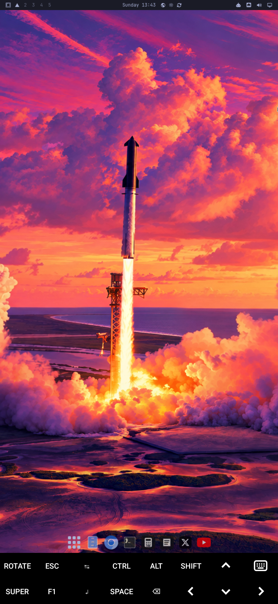
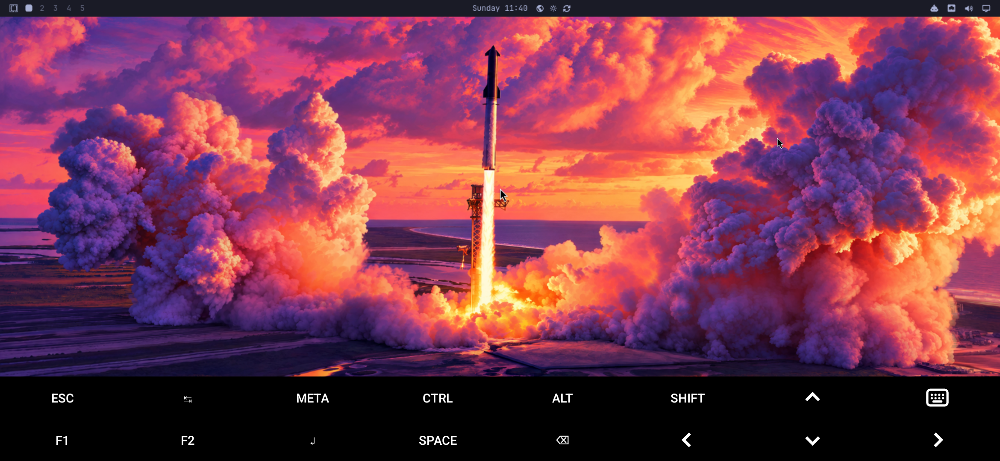

# Omarchy Mobile

Real [Omarchy](https://omarchy.org) on an Android phone. No root, no
bootloader unlock, nothing wiped: the phone keeps running Android, and Omarchy
runs in a virtual machine on it, drawn by the phone's own GPU.

<p>
  
  
</p>

> Unofficial community project, not affiliated with Omarchy, Basecamp or 37signals.

## What you get

- **Stock Omarchy 4 for ARM**, the same image Omarchy's own
  [Try Omarchy](https://github.com/omacom/try-omarchy) app runs on Apple Silicon
  Macs. Setup, Hyprland, the Omarchy shell and bar, themes, `omarchy update`:
  all upstream, nothing patched inside.
- **GPU-accelerated graphics.** The VM's OpenGL runs on the phone's GPU
  (virgl → Zink → Turnip, the open Vulkan driver for Qualcomm Adreno).
- **A home-screen icon.** Tap it to boot Omarchy, tap it again to come back to it.
- **Portrait or landscape, switchable live** with the ROTATE key: Omarchy
  re-lays itself out for the new shape.
- Touch as a mouse, the phone's keyboard, and a key bar with the keys phones
  lack: SUPER, ESC, CTRL, ALT, TAB, arrows.

## Honest status

It works, and it is slow. Stock Android gives apps no hardware virtualization,
so QEMU emulates the CPU instruction by instruction. Graphics are fast (real
GPU); everything the CPU does is several times slower than native.

| Galaxy S23 (Snapdragon 8 Gen 2) | All cores (shared-uid Termux:X11, or launched over USB) | Efficiency cores only (regular Termux:X11 from the icon) |
|---|---|---|
| First boot to setup screen | about 35 min (Omarchy creates its keys and finishes hardware setup) | |
| Later boots: Hyprland running | about 5 min | about 19 min |
| Later boots: full desktop (bar, wallpaper, config settled) | about 10 min | 25+ min |
| Desktop | usable but sluggish; apps take seconds to open | slower still |

**Known limits**

- **Termux:X11 must be the shared-uid build.** Android gives an app that is
  not on screen only the efficiency cores. With the regular Termux:X11, Termux
  (which runs the VM) counts as background whenever Omarchy is on screen, and
  boots take two to three times longer. `install-apps.sh` installs the
  `sharedUid` build, which runs inside the Termux process, so the VM keeps
  every core.
- **Hyprland is patched in the guest.** Hyprland gives each Lua config reload
  1.5 s, a constant compiled into it, and Omarchy's config takes longer on an
  emulated CPU ("Your config has errors … execution timed out"). The guest
  setup rewrites that one instruction to 15 s, only when it matches exactly,
  and re-applies it after Hyprland updates (details in
  [docs/debugging.md](docs/debugging.md)). A configurable limit upstream
  would make this unnecessary.
- No sound, camera or phone/SMS inside Omarchy, and no shared clipboard yet.
- Omarchy is a keyboard-driven desktop; a USB-C or Bluetooth keyboard helps a lot.

## Devices

| Device | vm | container | native | Notes |
|---|---|---|---|---|
| [Samsung Galaxy S23 (SM-S911U, T-Mobile)](devices/samsung-dm1q-sm-s911u/) | works | works | blocked | US Snapdragon: no OEM unlock |

Any 64-bit Android phone should run the **vm** tier. Snapdragon phones (Adreno
6xx/7xx) get GPU acceleration; others fall back to software graphics, which is
much slower. [docs/tiers.md](docs/tiers.md) explains the tiers. Tried it on
another phone? See [Adding your phone](#adding-your-phone).

## Install

You need:

- a Mac or Linux computer with `adb` and `curl`
  (macOS: `brew install --cask android-platform-tools`;
  Debian/Ubuntu: `sudo apt install adb curl`)
- a 64-bit Android phone with about 16 GB free, 8 GB of RAM recommended, and
  **USB debugging** on (Settings > About phone > Software information: tap
  "Build number" 7 times, then Settings > Developer options > USB debugging)

The three Android apps (Termux, the shared-uid Termux:X11, Termux:Widget)
are mirrored, checksum-verified, in this repo's
[apps release](https://github.com/lalomorales22/Omarchy-mobile/releases/tag/apps-1);
the installer downloads them from there.

Connect the phone, accept the "Allow USB debugging?" prompt, then:

```sh
git clone https://github.com/lalomorales22/Omarchy-mobile
cd Omarchy-mobile
./install.sh            # or: ./install.sh --portrait
```

The installer checks the phone, then downloads and verifies everything itself:
Termux, Termux:X11 and Termux:Widget from their GitHub releases (an existing
Play Store or F-Droid Termux is replaced, after asking), the Linux packages,
and the 3 GB Omarchy image. At the end, tap **Omarchy**, then **Add**, to put
the icon on your home screen. If anything fails, run it again: every step
picks up where it stopped.

<details><summary>What it runs, step by step</summary>

```sh
scripts/probe.sh                               # fingerprint the phone, see which tiers it can reach
scripts/install-apps.sh                        # Termux, Termux:X11, Termux:Widget (verified APKs) + Android settings
scripts/termux-run.sh phone/01-termux-base.sh  # X11, QEMU dependencies, Adreno GPU drivers
scripts/termux-run.sh phone/10-vm-image.sh     # ~3 GB download, verified, unpacks to a 20 GB sparse disk
scripts/install-launcher.sh --pin              # `omarchy` command + home-screen icon
```

`install-apps.sh` also changes three Android settings so the VM survives in
the background: it turns off "verify apps over USB" (which blocks the Termux
builds), Android 12+'s phantom-process killer, and battery optimisation for
Termux, and lets Termux start from the home screen.

</details>

## Using it

- **Start:** tap the Omarchy icon. The first boot asks for keyboard layout,
  name and password, then starts the desktop. Later boots go straight to it.
- **The key bar:**

  ```
  ROTATE  ESC  TAB  CTRL   ALT  SHIFT  ↑  ⌨
  SUPER   F1   ↵    SPACE  ⌫    ←      ↓  →
  ```

  SUPER is Omarchy's main key, and the bar's modifiers are sticky: tap SUPER,
  then the key. SUPER then ↵ opens a terminal, SUPER then SPACE the app
  launcher. ⌨ opens the phone's keyboard.
- **Orientation:** ROTATE flips between portrait and landscape; Omarchy
  redraws for the new shape in under a minute. The choice is remembered for
  the next boot (or set it in Termux: `omarchy portrait`, `omarchy landscape`).
- **Full speed:** with the phone on USB, `scripts/vm-up.sh` boots it with every
  CPU core (see [Known limits](#honest-status)).
- **Stop:** shut down from inside Omarchy, like any computer.

Settings such as `OMARCHY_VM_RAM=6G` can go in `~/omarchy-vm/config` inside
Termux; [phone/start-vm.sh](phone/start-vm.sh) lists them all.

## How it works

- **The image.** [omacom/try-omarchy](https://github.com/omacom/try-omarchy)
  publishes a stock generic-aarch64 Omarchy disk, built with Omarchy's own
  install steps. `phone/10-vm-image.sh` pins a release and its SHA-256 digests.
- **The VM.** `phone/start-vm.sh` mirrors Try Omarchy's virtual hardware
  (UEFI, virtio disk, network, input and `virtio-gpu-gl`) with QEMU's
  multi-threaded TCG in place of Apple's hypervisor. It turns off the CPU
  features that are expensive to emulate (SVE, SME, pointer authentication).
- **The GPU.** Guest OpenGL goes through virgl to Mesa's Zink on Turnip, over
  Android's KGSL interface: `virgl (zink Vulkan 1.4 (Turnip Adreno 740))`.
- **Slow-boot fixes.** Omarchy's timeouts assume real hardware: systemd waits
  90 s for disks, and uwsm 30 s for Hyprland. Under emulation each needs
  minutes. The launcher raises the disk timeout on the guest's kernel command
  line, copies [phone/guest-setup.sh](phone/guest-setup.sh) to its boot
  partition, and passes a one-line systemd unit (as a credential) that runs
  it before the first login. Omarchy itself is never modified.
- **The screen.** Termux:X11 shows QEMU's window full screen (Openbox keeps
  it there) at 150% scale, which is readable on a phone and leaves fewer
  pixels for the emulated CPU to draw.
- **Rotation.** ROTATE sends CTRL+SHIFT+F12. QEMU holds the keyboard grab, so
  a tiny listener ([phone/rotate-keys.c](phone/rotate-keys.c), built on the
  phone) reads XInput2 raw key events, which arrive regardless, and runs
  `omarchy-rotate`. Termux:X11 changes orientation, Openbox resizes QEMU's
  window, and QEMU gives the virtual monitor a new preferred mode. Hyprland
  keeps the mode list it read at startup, so a small watcher in the guest
  (`omarchy-mobile-screen`) sets the new mode explicitly.
- **Driving the phone from the computer.** The Termux GitHub build is
  debuggable, so `adb shell run-as com.termux` reaches its files and
  environment, and `scripts/termux-run.sh` pipes setup scripts into it.
- **Why not Hyprland straight in Termux?** Android's SELinux policy keeps apps
  away from `/dev/dri`, and Hyprland allocates every buffer on a DRM device. A
  VM brings its own kernel and virtual GPU, so Hyprland gets one.

## Troubleshooting

[docs/debugging.md](docs/debugging.md) covers the QEMU monitor, guest
screenshots, a root shell inside the VM (`OMARCHY_VM_DEBUG=1`), and every
first-boot snag found so far: the emergency shell, a black screen after setup,
and Limine kernel paths.

## Roadmap

- **Standalone app.** QEMU, the GPU drivers and the display in one APK: no
  Termux, no computer.
- **Phone-only install.** Install Termux, paste one line, done.
- **Native tier.** Omarchy as the phone's only OS on phones with an unlockable
  bootloader and mainline Linux (OnePlus 6/6T, Poco F1, and the international
  Galaxy S23 once its [port](https://github.com/MrCamel-Baraa/dm1q-mainline)
  has display and GPU support).

## Adding your phone

1. Run `./install.sh`. Its first step, `scripts/probe.sh`, writes
   `devices/<brand>-<codename>-<model>/probe.md`.
2. Note what worked, what broke, and how long the boots took.
3. Copy [devices/TEMPLATE.md](devices/TEMPLATE.md) to `devices/<id>/README.md`,
   fill it in, add a row to the table above, and open a pull request.

## Credits

[Omarchy](https://github.com/basecamp/omarchy) and
[Try Omarchy](https://github.com/omacom/try-omarchy) by DHH and contributors,
[Termux](https://github.com/termux/termux-app),
[Termux:X11](https://github.com/termux/termux-x11),
[Termux:Widget](https://github.com/termux/termux-widget),
[QEMU](https://www.qemu.org), [Mesa](https://mesa3d.org),
[virglrenderer](https://gitlab.freedesktop.org/virgl/virglrenderer),
[Arch Linux ARM](https://archlinuxarm.org).

## License

[MIT](LICENSE). Omarchy, Termux and the other projects above keep their own
licenses; this repo downloads them and contains none of their code.
